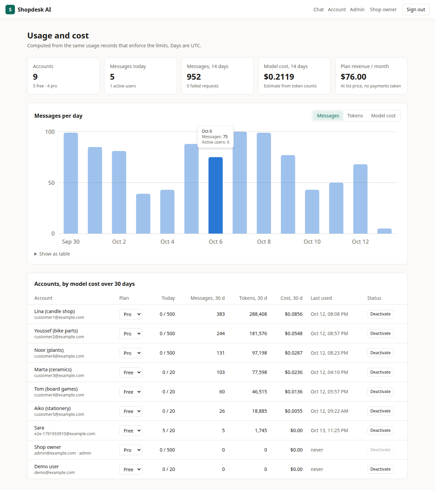
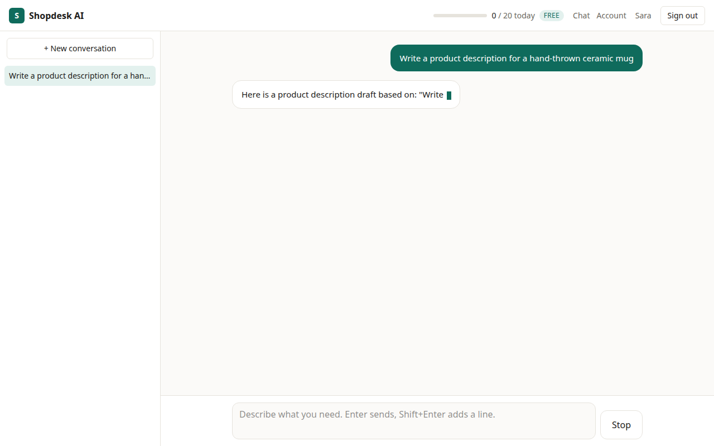
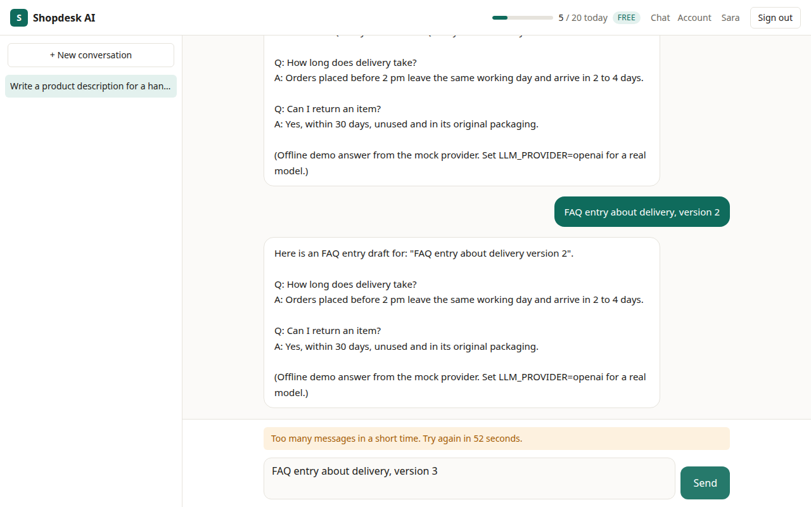
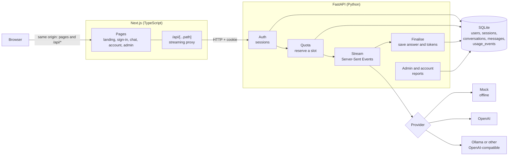

# Full-stack AI SaaS app (Next.js + FastAPI)

A small but complete AI product, not just a chat box: accounts, plans with usage limits that the
server enforces, answers streamed word by word, saved history, and an admin page that shows who
used what and what it cost.

The example product is **Shopdesk AI**, a writing assistant for small online shops (product
descriptions, customer replies, FAQ entries). The product is a stand-in: the parts worth reusing
are the ones every paid AI feature needs and most demos skip.

It runs on a laptop with one command and **no API key**. The same code talks to OpenAI, or to a
local model through Ollama, by changing one setting.



| Chat, mid-stream | A limit being enforced |
|---|---|
|  |  |

## What it does

- **Accounts.** Sign-up, sign-in, sign-out. Passwords are stored as scrypt hashes. A session is a
  random token in an httpOnly cookie; the database keeps only its hash, and sign-out deletes it.
  Five wrong passwords lock the email for 15 minutes.
- **Plans and limits.** Free and Pro, each with a daily message limit, a daily token limit, a
  per-minute burst limit and a cap on answer length. Limits are checked on the server, in the
  same database transaction that records the request.
- **Streaming.** Answers arrive word by word over Server-Sent Events. A Stop button cancels the
  request all the way to the model, and the partial answer is kept and counted.
- **History.** Conversations are saved per user: list, open, rename, delete. Nobody can read or
  write another user's conversation.
- **Admin page.** Daily messages, tokens and estimated model cost, a per-account table sorted by
  cost, plan change and account deactivation.
- **Three model providers behind one interface.** An offline mock (deterministic, used by the
  tests), OpenAI, and any OpenAI-compatible server such as Ollama.

## Architecture



One request, step by step:

1. The browser posts the message to `/api/chat/stream` on the Next.js server, which forwards it
   to the API with the session cookie.
2. In **one write transaction** the API identifies the user, counts today's usage, and, if there
   is room, writes a usage record with the state `started`. That record is the reservation. If
   there is no room it answers `429` with the reason and the time of the reset.
3. The API calls the provider and forwards each piece of text as an SSE `delta` event. No
   database connection is held during this time.
4. When the stream ends, or the browser goes away, the API saves the answer and fills in the
   usage record with input tokens, output tokens and estimated cost.
5. The user's meter and the admin page read the same usage records, so they cannot disagree with
   what was enforced.

## Quick start

Needs Python 3.11+ and Node.js 20+.

```bash
git clone https://github.com/BelAnas/ai-saas-starter-nextjs.git
cd ai-saas-starter-nextjs
./dev.sh
```

The script installs both parts on the first run, creates demo data, and starts the API on port
8000 and the web app on port 3000. Open <http://localhost:3000> and sign in:

| Account | Email | Password |
|---|---|---|
| User (Free plan) | `demo@example.com` | `demo-demo-1` |
| Administrator | `admin@example.com` | `admin-demo-1` |

These demo accounts and the two weeks of usage shown on the admin page are synthetic, generated
by `backend/app/seed.py`. Do not deploy with them.

Other ports: `API_PORT=8001 WEB_PORT=3001 ./dev.sh`. Production build of the web app:
`./dev.sh prod`.

### Real output

The stream, as the browser receives it (`curl -N` through the Next.js proxy, offline provider):

```text
event: meta
data: {"conversation_id": 4, "title": "Write an FAQ entry about returns", "is_new": true, "model": "mock-1"}

event: delta
data: {"text": "Here "}

event: delta
data: {"text": "is "}
...
event: done
data: {"message_id": 18, "status": "completed", "usage": {"input_tokens": 74, "output_tokens": 90, "estimated": false, "cost_usd": 0.0}, "quota": {"plan": "free", "messages_used": 2, "messages_limit": 20, "tokens_used": 249, "tokens_limit": 20000, "resets_at": "2026-10-14T00:00:00Z"}}
```

A refused request:

```json
{"detail": "Too many messages in a short time. Try again in 52 seconds.", "code": "burst", "retry_after": 52,
 "quota": {"plan": "free", "messages_used": 5, "messages_limit": 20, "tokens_used": 1045, "tokens_limit": 20000, "resets_at": "2026-10-14T00:00:00Z"}}
```

## Results

Every number below was produced by the command next to it, on an 8-core CPU machine.

| What | Result | Command |
|---|---|---|
| API tests | 37 passed | `cd backend && .venv/bin/python -m pytest -q` |
| Front-end unit tests (stream parser, chart axis) | 5 passed | `cd frontend && npm test` |
| Browser test of the whole product | 9 of 9 steps passed | `backend/.venv/bin/python scripts/e2e.py --web http://localhost:3023` |
| 50 requests at once against a limit of 20 | exactly 20 served, 30 refused | `pytest tests/test_quota.py -k parallel` |
| First word, direct to the API | median 26 ms (whole answer 1732 ms) | `scripts/bench_stream.py` |
| First word, through the Next.js proxy | median 29 ms (whole answer 1734 ms) | `scripts/bench_stream.py --web http://localhost:3023` |
| 100 streams at once, one API process | all completed in 2.76 s; first word p50 420 ms, p95 847 ms | `scripts/bench_stream.py` |
| Real model (llama3.2 3B on CPU, through Ollama) | passed: first word 3.79 s, answer 11.41 s, 91 + 74 tokens reported by the provider and recorded | `scripts/live_check.py` |

How to read them:

- The benchmark uses the offline provider at 20 ms per word, so it measures this code, not a
  model. The answer takes 1.7 s in total and its first word arrives after 29 ms through the proxy:
  the proxy passes the stream on, it does not wait for the end.
- The 420 ms median under 100 simultaneous streams is the queue for the database write lock:
  reservations happen one at a time. That is the price of the guarantee in the row above it.
- The live check used a local model because no OpenAI key was available in this build. The
  OpenAI path uses the same provider class and wire protocol, but was not run against OpenAI.

## Configuration

Copy `.env.example` to `.env`. Every value is optional.

| Variable | Default | Meaning |
|---|---|---|
| `LLM_PROVIDER` | `mock` | `mock` (offline) or `openai` (OpenAI and compatible servers) |
| `OPENAI_API_KEY` | empty | Key for the provider; not needed for Ollama |
| `OPENAI_BASE_URL` | `https://api.openai.com/v1` | For Ollama: `http://127.0.0.1:11434/v1` |
| `OPENAI_MODEL` | `gpt-4o-mini` | Model name sent to the provider |
| `COOKIE_SECURE` | `false` | Set to `true` behind HTTPS |
| `DATABASE_URL` | SQLite file in `backend/data/` | SQLAlchemy URL |
| `API_PORT`, `WEB_PORT` | `8000`, `3000` | Ports used by `./dev.sh` |

Plans and model prices are in `backend/app/plans.py`. The prices there are configuration to keep
up to date, not a measurement.

Use a real model:

```bash
# OpenAI
echo 'LLM_PROVIDER=openai'  >> .env
echo 'OPENAI_API_KEY=sk-...' >> .env

# or a local model with Ollama, no key
LLM_PROVIDER=openai OPENAI_BASE_URL=http://127.0.0.1:11434/v1 OPENAI_MODEL=llama3.2 ./dev.sh
```

## Tests

```bash
cd backend
.venv/bin/pip install -r requirements-dev.txt
.venv/bin/python -m pytest -q            # 37 tests, offline, about 6 seconds

cd ../frontend
npm test                                 # stream parser and chart helpers
npm run typecheck && npm run lint

# Browser test (needs Google Chrome and the app running via ./dev.sh)
cd ..
backend/.venv/bin/pip install -r scripts/requirements-e2e.txt
backend/.venv/bin/python scripts/e2e.py --web http://localhost:3000
```

What the API tests cover: the account flow and lock-out, cookies and hashes, streaming events,
context sent to the model, all three limits and the midnight reset, the parallel-request race,
privacy between users, provider failures (charged only if text was produced), a dropped
connection against a real server, admin access control, account deletion and the seed data.

## Project structure

```text
dev.sh                      one command: install, seed, start both servers
backend/
  app/main.py               application factory
  app/config.py             settings from the environment
  app/db.py                 engine, sessions, SQLite write locking
  app/models.py             tables
  app/security.py           password hashing, session tokens
  app/plans.py              plans, limits, model prices
  app/quota.py              reserve and finish a usage record
  app/reports.py            daily usage queries
  app/llm/                  provider contract, mock, OpenAI-compatible
  app/routers/              auth, chat (streaming), conversations, account, admin
  app/seed.py               synthetic demo data
  tests/                    37 tests
frontend/
  app/                      pages: landing, login, register, app, account, admin
  app/api/[...path]/route.ts  streaming proxy to the API
  components/               chat workspace, admin dashboard, usage chart, forms
  lib/                      API client, SSE parser, types, formatting
scripts/
  bench_stream.py           streaming benchmark
  live_check.py             one real-model request through the whole API
  e2e.py                    browser test, also takes the screenshots
```

## Limits

- **No payments.** There is no Stripe or other checkout. An administrator changes the plan of an
  account. "Plan revenue" on the admin page is list price times accounts, not money received.
- **No email.** No address verification and no password reset.
- **SQLite, one API process.** Reservations queue on a single write lock (see the 100-stream
  result). For more than one server, move to PostgreSQL and lock the user's row instead; the
  models are plain SQLAlchemy, but that change was not made or tested here. There are no
  migrations: tables are created at start.
- **Token counts.** With OpenAI-compatible providers the counts are the provider's own. The
  offline provider and any provider that reports nothing use an estimate of four characters per
  token, and such rows are flagged as estimated.
- **A user can pass the daily token limit by one answer**, because tokens are only known after
  the answer. The cap on answer length bounds the overshoot.
- **Cost is an estimate** from token counts and a price table in the code.
- **CSRF protection is the SameSite=Lax cookie only**; there is no separate CSRF token or Origin
  check. Login lock-out is per email, not per IP address.
- **The OpenAI path was not run against OpenAI in this build** (no key). It is covered by tests
  with a simulated HTTP server and by a live run against Ollama.
- **Answers are shown as plain text.** No Markdown rendering, no file upload, no light/dark
  switch. The conversation list shows the latest 100 and has no search.
- **The offline provider is not a language model.** It fills a template chosen by keywords.
- **Not included:** Docker files, CI, rate limiting by IP, audit log of admin actions, teams or
  organisations, social sign-in.

## License

MIT. See [LICENSE](LICENSE).
